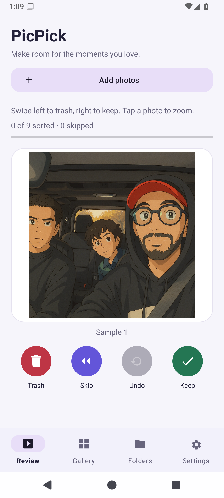
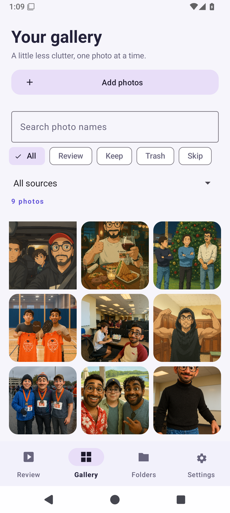
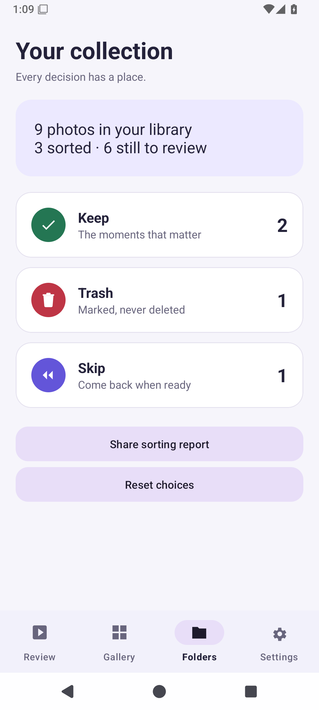
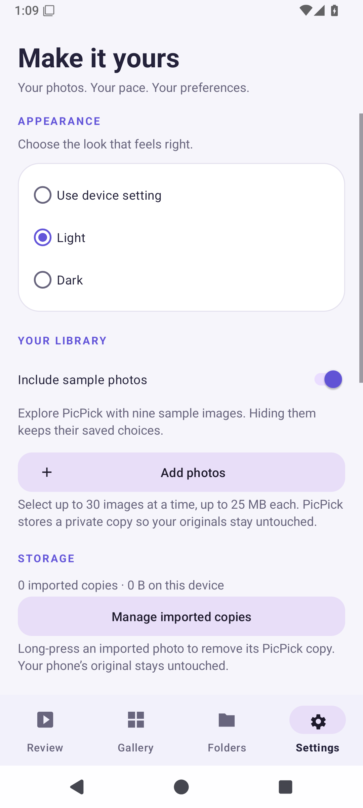
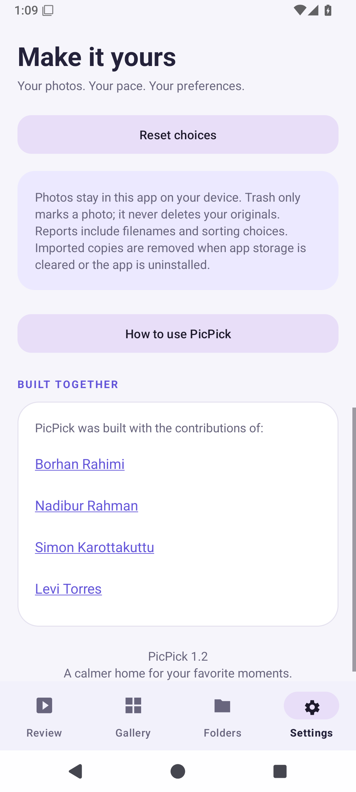
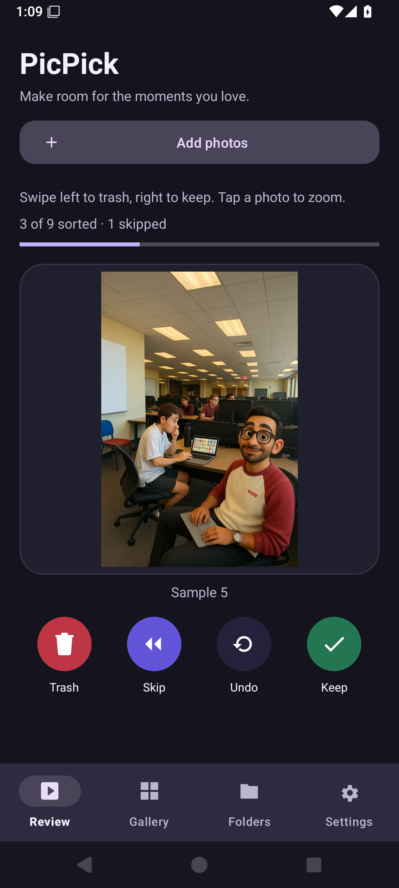

# PicPick

### Make room for the moments you love.

PicPick is a native Android photo organizer that turns a crowded photo collection into a simple decision: **Keep, Trash, or Skip**. Import selected photos, review them at your own pace, and find your choices in organized folders.

**Your originals stay untouched.** PicPick works with private copies, and Trash marks a photo rather than deleting it from your phone.

**Android 8.0+ · Java · Material 3 · Light & dark themes · No account required**

[See the app](#screenshots) · [Explore features](#features) · [Run locally](#run-locally) · [Meet the team](#credits)

## Screenshots

Real screenshots captured from PicPick 1.2 running on an Android 15 / API 35 emulator with the bundled sample library.

| Review | Search & filter | Organized folders |
|:---:|:---:|:---:|
|  |  |  |

| Settings | Team credits | Dark appearance |
|:---:|:---:|:---:|
|  |  |  |

## Why PicPick?

Reviewing photos is easier when you can focus on one image instead of an entire camera roll. PicPick provides a repeatable flow for keeping favorites, setting unwanted images aside, and returning to uncertain choices later—with undo available when you change your mind.

The app includes nine sample images so you can explore it before importing anything personal.

## Features

| Feature | What you can do |
|---|---|
| **Photo import** | Choose up to 30 images per import through Android's picker. Identical file contents are detected as duplicates. |
| **Quick review** | Swipe right to Keep, left to Trash, or use the labeled buttons. Skip photos to revisit later. |
| **Photo inspection** | Tap a review photo to open the viewer. Pinch to zoom, drag to pan, and double-tap to zoom or reset. |
| **Multi-step undo** | Restore up to 100 recent decisions, including after restarting the app. |
| **Search & filters** | Find photos by name and filter by sorting status or imported/sample source. |
| **Folders & progress** | See collection counts, review progress, and clear completion states. |
| **Storage controls** | See imported-copy storage usage. Long-press an imported photo or use its viewer to remove its app copy after confirmation. |
| **Personal settings** | Choose light, dark, or device appearance; hide sample photos; and replay the welcome guide. |
| **CSV reports** | Share filenames and sorting choices through Android's share sheet. |

## How it works

1. **Add photos** or start with the samples. PicPick copies selected images into its private storage.
2. **Review one photo at a time.** Keep a favorite, mark it as Trash, or Skip the decision.
3. **Inspect and undo.** Open a photo to zoom in, or undo recent sorting choices.
4. **Find your photos.** Search Gallery or browse Keep, Trash, and Skip folders.
5. **Finish your session.** Revisit skipped photos, share a report, or manage imported copies in Settings.

The first-run guide explains these controls and is available again under **Settings → How to use PicPick**.

## Run locally

### Requirements

- JDK 17.
- Android SDK Platform 35 and build tools.
- An Android phone or emulator running API 26 or newer.

Android Studio is optional if your JDK and Android SDK are already installed. You can edit and build the project from VS Code.

```sh
git clone https://github.com/borhanrahimi/PicPick.git
cd PicPick
```

Set your SDK location in an untracked `local.properties` file:

```properties
sdk.dir=/absolute/path/to/Android/sdk
```

Build an APK:

```sh
./gradlew assembleDebug
```

Install on a running emulator or USB-connected Android phone:

```sh
./gradlew installDebug
```

Open **PicPick** from the device's app list. The APK is generated at `app/build/outputs/apk/debug/app-debug.apk`.

On Windows, use `gradlew.bat` in place of `./gradlew`. If installation reports **No connected devices**, start an emulator or connect an Android phone with USB debugging enabled. Building the APK does not require a device.

### Browser preview

Upload the debug APK to your [Appetize](https://appetize.io/) account to run the native app in a browser and obtain a share link. A public demo URL is not configured in this repository. Hosting limits apply; see [Appetize's Android upload guide](https://docs.appetize.io/platform/app-management/uploading-apps/android).

The hosted device sees its own media library. Start with PicPick's sample photos, or add media to that virtual device before testing import.

## Privacy & storage

- Photos and sorting choices stay in app-private storage. No account, server, network permission, or broad photo-library permission is required.
- Import creates a copy; it does not edit or delete your original photo. Supported imports are limited to **25 MB** and **100 megapixels** per image.
- Removing an imported copy requires confirmation and removes its PicPick classification/history. Sample photos can be hidden, but not individually removed.
- Hiding samples preserves their saved choices. Reset affects visible photos. Reset, sample-visibility changes, and requeuing skipped photos clear undo history.
- CSV reports include visible photo labels and classifications. Quoting and spreadsheet-formula protection are applied to filenames.
- Android backup and device transfer of app data are disabled. Uninstalling or clearing app storage removes imported copies and saved choices; retain your originals elsewhere.

## Built with

Java, Android XML layouts, Material Components, AndroidX Activity Result APIs, SharedPreferences, and app-private file storage. Images load on background workers with sampling, EXIF orientation correction, and a memory cache.

See [the development guide](docs/DEVELOPMENT.md) for architecture, test commands, and screenshot capture instructions.

## Credits

PicPick was built with the contributions of:

| Contributor | Profile |
|---|---|
| **[Borhan Rahimi](https://www.linkedin.com/in/borhanrahimi/)** | [LinkedIn](https://www.linkedin.com/in/borhanrahimi/) |
| **[Nadibur Rahman](https://www.linkedin.com/in/nadibur-rahman/)** | [LinkedIn](https://www.linkedin.com/in/nadibur-rahman/) |
| **[Simon Karottakuttu](https://www.linkedin.com/in/simon-karottakuttu/)** | [LinkedIn](https://www.linkedin.com/in/simon-karottakuttu/) |
| **[Levi Torres](https://www.linkedin.com/in/torres-levi/)** | [LinkedIn](https://www.linkedin.com/in/torres-levi/) |

Thank you to everyone above for helping build PicPick. These credits and profile links are also available under **Settings → Built together**.

## Contributing

Open an issue describing the problem or proposed improvement. For code changes, include what changed and how you tested it. Useful next steps include larger-library performance, accessibility testing, and automated release builds.

## License

No license file has been added yet. Reuse permissions have not been specified.
