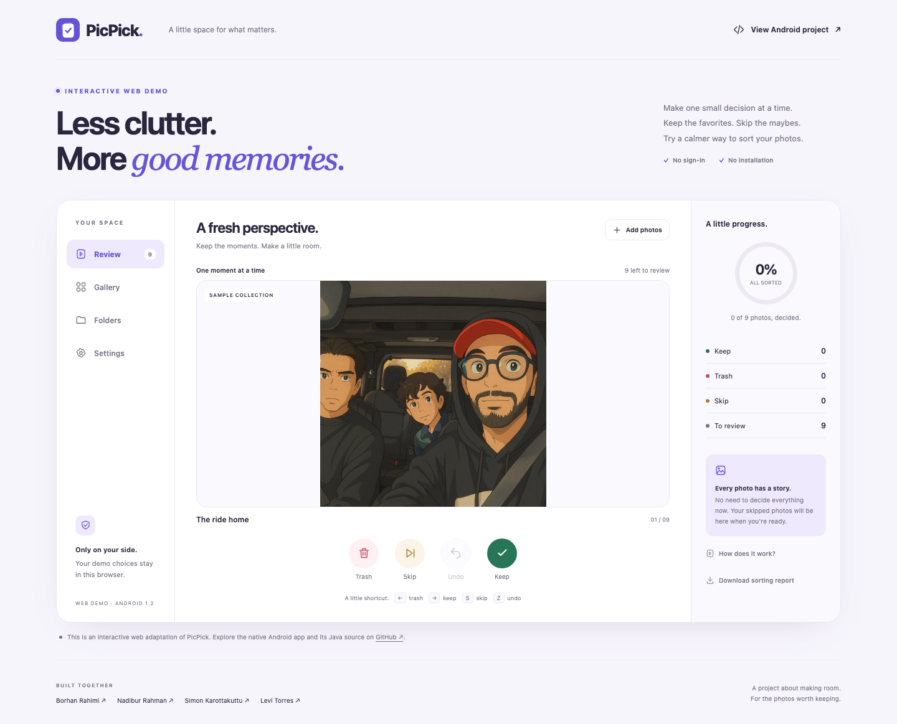

# PicPick

### Make room for the moments you love.

PicPick is a native Android app for organizing photos with three simple choices: **Keep, Trash, or Skip**. Import selected images, review one at a time, and browse your decisions in organized folders. Built with Java and Material 3, it includes swipe controls, multi-step undo, photo zoom, search, and local storage.

**Your originals stay untouched.** PicPick works with private copies, and Trash marks a photo rather than deleting it from your phone.

**Android 8.0+ · Java · Material 3 · Light & dark themes · No account required**

**[▶ Try the Android app in your browser](https://appetize.io/app/b_qhlt77l5uzx7wzrknd4lwdoeve)** · [Screenshots](#screenshots) · [Features](#features) · [Setup](#run-locally) · [Team](#credits)

## Try PicPick

| Experience | Best for | Access |
|---|---|---|
| **Native Android demo** | Trying the Android app in a streamed virtual device | **[Launch on Appetize](https://appetize.io/app/b_qhlt77l5uzx7wzrknd4lwdoeve)** |
| **Interactive web adaptation** | Exploring sorting, folders, and themes in your own browser | [Local preview and GitHub Pages setup](#interactive-browser-demo) |
| **Android source & APK** | Reviewing the implementation or running it on an Android device | [Build and run](#run-locally) |

For a quick tour, open the Android demo, keep one sample photo, skip another, try Undo, and explore Folders and Settings. Appetize usage limits depend on the hosting account; screenshots below remain available if a streaming session cannot start. The virtual device uses its own media library, so start with the bundled samples.

## Screenshots

Real screenshots captured from PicPick 1.2 running on an Android 15 / API 35 emulator with the bundled sample library.

| Review | Search & filter | Organized folders |
|:---:|:---:|:---:|
|  |  |  |

| Settings | Team credits | Dark appearance |
|:---:|:---:|:---:|
|  |  |  |

## Why PicPick?

Reviewing photos is easier when you can focus on one image instead of an entire camera roll. PicPick provides a repeatable flow for keeping favorites, setting unwanted images aside, and returning to uncertain choices later—with undo available when you change your mind.

The app includes nine sample images so you can explore it before importing anything personal.

## Features

| Feature | What you can do |
|---|---|
| **Photo import** | Choose up to 30 images per import through Android's picker. Identical file contents are detected as duplicates. |
| **Quick review** | Swipe right to Keep, left to Trash, or use the labeled buttons. Skip photos to revisit later. |
| **Photo inspection** | Tap a review photo to open the viewer. Pinch to zoom, drag to pan, and double-tap to zoom or reset. |
| **Multi-step undo** | Restore up to 100 recent decisions, including after restarting the app. |
| **Search & filters** | Find photos by name and filter by sorting status or imported/sample source. |
| **Folders & progress** | See collection counts, review progress, and clear completion states. |
| **Storage controls** | See imported-copy storage usage. Long-press an imported photo or use its viewer to remove its app copy after confirmation. |
| **Personal settings** | Choose light, dark, or device appearance; hide sample photos; and replay the welcome guide. |
| **CSV reports** | Share filenames and sorting choices through Android's share sheet. |

## How it works

1. **Add photos** or start with the samples. PicPick copies selected images into its private storage.
2. **Review one photo at a time.** Keep a favorite, mark it as Trash, or Skip the decision.
3. **Inspect and undo.** Open a photo to zoom in, or undo recent sorting choices.
4. **Find your photos.** Search Gallery or browse Keep, Trash, and Skip folders.
5. **Finish your session.** Revisit skipped photos, share a report, or manage imported copies in Settings.

The first-run guide explains these controls and is available again under **Settings → How to use PicPick**.

## Run locally

### Requirements

- JDK 17.
- Android SDK Platform 35 and build tools.
- An Android phone or emulator running API 26 or newer.

Android Studio is optional if your JDK and Android SDK are already installed. You can edit and build the project from VS Code.

```sh
git clone https://github.com/borhanrahimi/PicPick.git
cd PicPick
```

Set your SDK location in an untracked `local.properties` file:

```properties
sdk.dir=/absolute/path/to/Android/sdk
```

Build an APK:

```sh
./gradlew assembleDebug
```

Install on a running emulator or USB-connected Android phone:

```sh
./gradlew installDebug
```

Open **PicPick** from the device's app list. The APK is generated at `app/build/outputs/apk/debug/app-debug.apk`.

On Windows, use `gradlew.bat` in place of `./gradlew`. If installation reports **No connected devices**, start an emulator or connect an Android phone with USB debugging enabled. Building the APK does not require a device.

## Interactive browser demo

The repository now includes a working browser adaptation in [`web/`](web/README.md). Visitors can sort the samples, undo choices, explore folders, search/filter photos, change themes, inspect photos, and download a report without installing Android software.



Preview it locally:

```sh
npm --prefix web start
```

Open **http://127.0.0.1:4173**. Node.js is needed only for the local preview and development tooling.

**Publishing target:** [borhanrahimi.github.io/PicPick](https://borhanrahimi.github.io/PicPick/). This address becomes the recruiter demo after the included GitHub Pages workflow is pushed and enabled. See the [publishing steps](web/README.md#publish-on-github-pages).

The web demo runs in the visitor’s browser, with no streamed-emulator session timer. It is clearly labeled as a web adaptation; the Java Android app remains the main project. Browser sample choices save locally, while personal photo imports remain in memory only until reload. Static-hosting quotas still apply.

## Privacy & storage

- Photos and sorting choices stay in app-private storage. No account, server, network permission, or broad photo-library permission is required.
- Import creates a copy; it does not edit or delete your original photo. Supported imports are limited to **25 MB** and **100 megapixels** per image.
- Removing an imported copy requires confirmation and removes its PicPick classification/history. Sample photos can be hidden, but not individually removed.
- Hiding samples preserves their saved choices. Reset affects visible photos. Reset, sample-visibility changes, and requeuing skipped photos clear undo history.
- CSV reports include visible photo labels and classifications. Quoting and spreadsheet-formula protection are applied to filenames.
- Android backup and device transfer of app data are disabled. Uninstalling or clearing app storage removes imported copies and saved choices; retain your originals elsewhere.

## Built with

Java, Android XML layouts, Material Components, AndroidX Activity Result APIs, SharedPreferences, and app-private file storage. Images load on background workers with sampling, EXIF orientation correction, and a memory cache.

See [the development guide](docs/DEVELOPMENT.md) for architecture, test commands, and screenshot capture instructions.

## Credits

PicPick was built with the contributions of all four team members:

<table>
  <tr>
    <td align="center" width="25%">
      <a href="https://www.linkedin.com/in/borhanrahimi/"></a><br>
      <strong><a href="https://www.linkedin.com/in/borhanrahimi/">Borhan Rahimi</a></strong><br>
      <a href="https://www.linkedin.com/in/borhanrahimi/">LinkedIn</a>
    </td>
    <td align="center" width="25%">
      <a href="https://www.linkedin.com/in/nadibur-rahman/"></a><br>
      <strong><a href="https://www.linkedin.com/in/nadibur-rahman/">Nadibur Rahman</a></strong><br>
      <a href="https://www.linkedin.com/in/nadibur-rahman/">LinkedIn</a>
    </td>
    <td align="center" width="25%">
      <a href="https://www.linkedin.com/in/simon-karottakuttu/"></a><br>
      <strong><a href="https://www.linkedin.com/in/simon-karottakuttu/">Simon Karottakuttu</a></strong><br>
      <a href="https://www.linkedin.com/in/simon-karottakuttu/">LinkedIn</a>
    </td>
    <td align="center" width="25%">
      <a href="https://www.linkedin.com/in/torres-levi/"></a><br>
      <strong><a href="https://www.linkedin.com/in/torres-levi/">Levi Torres</a></strong><br>
      <a href="https://www.linkedin.com/in/torres-levi/">LinkedIn</a>
    </td>
  </tr>
</table>

Portraits for Nadibur Rahman, Simon Karottakuttu, and Levi Torres are pending; their initials are clearly labeled placeholders. Contributor names and profile links are also available under **Settings → Built together**.

## Contributing

Open an issue describing the problem or proposed improvement. For code changes, include what changed and how you tested it. Useful next steps include larger-library performance, accessibility testing, and automated release builds.

## License

No license file has been added yet. Reuse permissions have not been specified.
